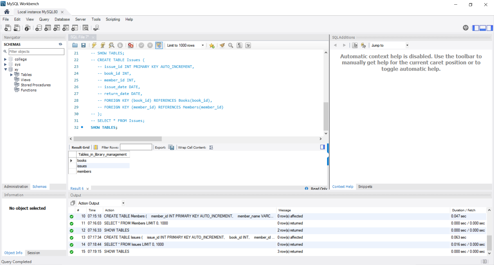
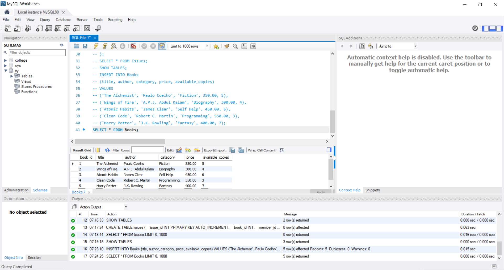
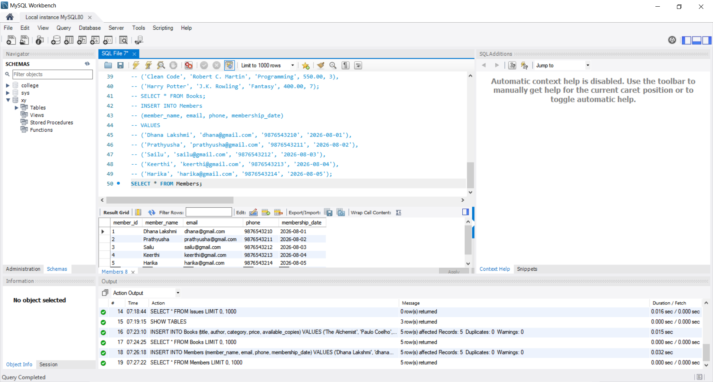
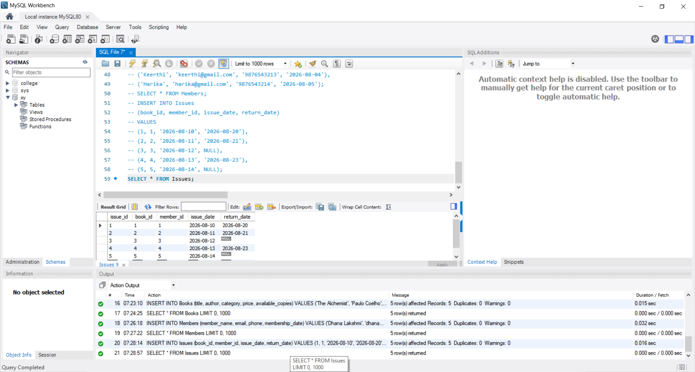
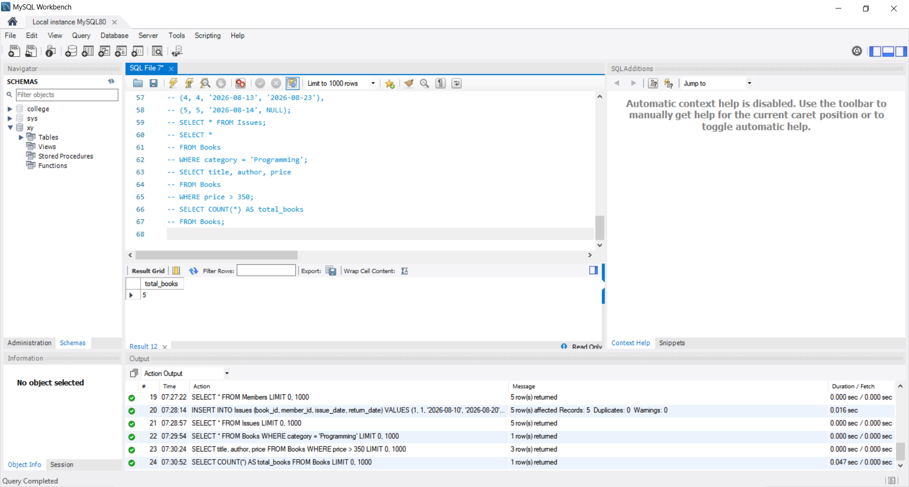
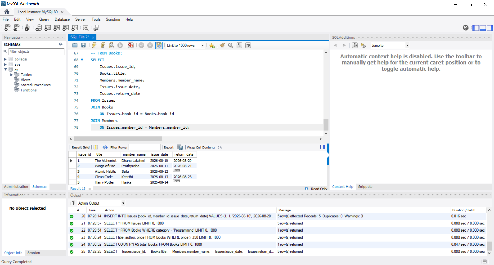

# CODTECH Internship Task-1

## Library Management Database

**Company:** CODTECH IT SOLUTIONS

**Intern Name:** GOGULAPATI LAKSHMI POORNIMA

**Intern ID:** CTIS9030

**Domain:** SQL

**Duration:** 12 Weeks

**Mentor Name:** Neela Santosh Kumar


## Objective

To design and implement a **Library Management Database** using MySQL for managing books, members, and book issue/return records.

## Description

This project implements a relational database using **MySQL and MySQL Workbench**. It includes tables for Books, Members, and Issues, with relationships established using Primary Keys and Foreign Keys.

## Database

**Database Name:** `library_management`

### Tables

* **Books** – Stores book details, category, price, and available copies.
* **Members** – Stores library member information.
* **Issues** – Stores book issue and return details.

## SQL Concepts Used

* CREATE DATABASE
* CREATE TABLE
* PRIMARY KEY & FOREIGN KEY
* INSERT INTO
* SELECT
* WHERE
* ORDER BY
* Aggregate Functions
* JOIN

## Operations Performed

* Created the Library Management database and tables.
* Inserted sample books, members, and issue records.
* Retrieved and filtered data using SQL queries.
* Used aggregate functions such as `COUNT()`, `AVG()`, `MAX()`, `MIN()`, and `SUM()`.
* Used JOIN queries to combine book, member, and issue information.

## Files in Repository

* `Task_1_Library_Management.sql`
* `README.md`
* `Screenshots/`

## Project Structure

```text id="e9b3ad"
Task_1_Library_Management/
│
├── Task_1_Library_Management.sql
├── README.md
│
└── Screenshots/
    ├── SS1_Database_Tables.png
    ├── SS2_Books.png
    ├── SS3_Members.png
    ├── SS4_Issues.png
    ├── SS5_Queries.png
    └── SS6_Join.png
```

## Conclusion

The Library Management Database was successfully implemented using MySQL. The project demonstrates essential SQL concepts for storing, retrieving, filtering, and managing relational data.

## Proof of Execution

### Database & Tables



### Books



### Members



### Issues



### Queries



### JOIN


